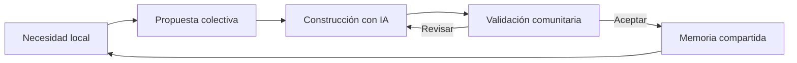

# Apropiación comunitaria, autonomía y construcción colectiva de conocimiento

**Supuestos de trabajo.** Público universitario y autodidacta, nivel introductorio-intermedio; conocimientos básicos de informática y alfabetización digital. Disciplina: inteligencia artificial y estudios sociotécnicos y educación. Contexto académico y aplicado. Unidad modular de extensión media.

## Fundamentación conceptual

La apropiación tecnológica es el proceso por el cual una comunidad incorpora, adapta y gobierna una tecnología para sus propios propósitos. No se reduce a tener acceso a dispositivos o aprender a utilizar una plataforma. Incluye capacidad de modificar prácticas, decidir prioridades, comprender dependencias y compartir resultados.

La autonomía comunitaria es relacional: una comunidad puede utilizar servicios externos y conservar control sobre decisiones, datos y continuidad, aunque ciertas dependencias limiten su margen de acción. La construcción colectiva de conocimiento requiere mecanismos de contribución, contraste, memoria y reconocimiento. Una IA puede ayudar a documentar experiencias, traducir materiales o explorar diseños, pero no sustituye la deliberación sobre qué conocimiento importa y quién puede utilizarlo.

Un repositorio compartido puede actuar como memoria viva si conserva versiones, fuentes y evidencia de funcionamiento. La apertura no exige publicar datos personales o conocimientos que una comunidad decida proteger. La gobernanza debe contemplar consentimiento, licencias, participación equitativa, posibilidad de disentir y mecanismos de continuidad.

## Formalización del conocimiento

Representemos una comunidad como una red G=(P,R), donde P son participantes y R relaciones de colaboración. Cada contribución puede registrarse como una tupla (artefacto, autoría, licencia, procedencia, evidencia, revisión, versión). Un proceso de incorporación propone, revisa, valida, acepta o devuelve una contribución.

Un indicador sencillo de continuidad es la proporción de tareas críticas que pueden ejecutar al menos dos participantes. Es un indicador operativo parcial, no una medida completa de autonomía ni de poder.

## Ejemplos e instancias

Caso hipotético: tres grupos de un espacio maker desarrollan un sensor ambiental. Un grupo documenta conexiones, otro calibra lecturas y otro construye visualizaciones. El repositorio conserva esquemas, datos de prueba no personales, código y problemas abiertos.

| Tarea crítica | Personas capaces antes | Después de intercambio |
|---|---:|---:|
| Montaje | 1 | 3 |
| Calibración | 1 | 2 |
| Publicación | 2 | 2 |
| Diagnóstico | 1 | 1 |

Con el criterio de dos personas, la cobertura pasa de 1/4 a 3/4. Los datos son inventados para mostrar el cálculo. El diagnóstico sigue siendo una dependencia crítica. La IA puede transformar notas en documentación, pero las personas deben validar las conexiones y resultados.

## Espacio de posibilidades

| Elemento | Modificación | Restricción | Consecuencia |
|---|---|---|---|
| Roles | Rotación o mentoría | Voluntariedad y acceso | Distribuye capacidades |
| Repositorio | Licencias y acceso granular | Consentimiento | Facilita reutilización |
| Infraestructura | Local o remota | Recursos y portabilidad | Cambia dependencia |
| Validación | Pares o pruebas compartidas | Criterios transparentes | Mejora trazabilidad |

## Activadores generativos

- Construir un repositorio comunitario de soluciones a problemas locales con documentación generativa, licencias y evidencia. Explorar contribuciones en distintos formatos e idiomas. ¿Quién puede reutilizarlo sin depender del autor?
- Diseñar un mapa de dependencias tecnológicas y un plan de continuidad ante pérdida de conectividad, plataforma o una persona clave. Producir un inventario y ensayar recuperación sin exponer datos sensibles. ¿Qué dependencias son aceptables para la comunidad?
- Crear una clínica de prototipos con liderazgo rotativo y registro de experimentos. Comparar versiones y transferencias entre grupos, respetando decisiones colectivas sobre publicación. ¿Qué aprendizajes surgen al adaptar una solución a otro contexto?

## Validación de las construcciones

Verificar que otra persona pueda reproducir un artefacto con la documentación disponible. Revisar permisos, licencias y procedencia antes de publicar. Comprobar recuperación de copias y portabilidad. Evaluar distribución de voz y capacidad de modificación además del número de participantes; no atribuir causalidad a indicadores descriptivos.

## Reflexión sobre el aprendizaje

¿Quién definió el problema? ¿Quién puede modificar lo construido? ¿Qué conocimiento debe permanecer bajo control local? ¿Cómo continuaríamos si desapareciera el servicio de IA?

## Conexiones con otros conocimientos

- [Tokens, contexto y generación de respuestas](../05.%20%20Agentes%20y%20sistemas%20inteligentes/tokens-contexto-generacion.md)
- [Modelos multimodales](../05.%20%20Agentes%20y%20sistemas%20inteligentes/modelos-multimodales.md)
- [Generación, búsqueda y razonamiento](../05.%20%20Agentes%20y%20sistemas%20inteligentes/generacion-busqueda-razonamiento.md)
- [Alucinaciones, verificación y evaluación de respuestas](../07.%20Filosof%C3%ADa%20y%20sociedad%20de%20la%20IA/alucinaciones-verificacion-evaluacion.md)
- [La IA como herramienta cognitiva](../07.%20Filosof%C3%ADa%20y%20sociedad%20de%20la%20IA/ia-herramienta-cognitiva.md)

## Referencias

[Ostrom, Governing the Commons](https://doi.org/10.1017/CBO9780511807763); [UNESCO, Recommendation on Open Science](https://unesdoc.unesco.org/ark:/48223/pf0000379949).

Este contenido puede ampliarse mediante contribuciones que incluyan procedencia, condiciones de reproducción, evidencia de validación y registro de cambios.
