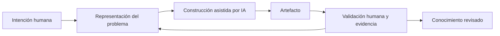

# La IA como herramienta cognitiva

**Supuestos de trabajo.** Público universitario y autodidacta, nivel introductorio-intermedio; conocimientos básicos de informática y alfabetización digital. Disciplina: inteligencia artificial y estudios sociotécnicos y educación. Contexto académico y aplicado. Unidad modular de extensión media.

## Fundamentación conceptual

Una herramienta cognitiva modifica las operaciones mediante las cuales las personas representan, exploran y transforman problemas. La escritura, los diagramas y los lenguajes de programación permiten externalizar parte del trabajo intelectual. La IA generativa agrega la posibilidad de producir y transformar representaciones a partir de instrucciones y contexto.

Desde la cognición distribuida, la unidad de análisis puede ser un sistema compuesto por personas, artefactos y prácticas. La tesis de la mente extendida propone condiciones bajo las cuales ciertos recursos externos pueden formar parte de procesos cognitivos. Aplicar estas perspectivas a la IA es una interpretación teórica, no una prueba de que un modelo posea conciencia o de que cualquier uso amplíe capacidades.

La delegación cognitiva puede liberar esfuerzo para formular hipótesis, comparar diseños y revisar resultados, pero también reducir práctica, comprensión o control si se aceptan salidas sin examinarlas. Importa la capacidad de formular intenciones, seleccionar representaciones, verificar resultados y decidir cuándo no delegar. La autonomía no implica prescindir de herramientas, sino conservar capacidad efectiva de dirigir, cuestionar y modificar el proceso.

## Formalización del conocimiento

Un modelo de actividad distribuida puede representarse mediante el estado S=(I,K,A,E), donde I es la intención humana, K el conocimiento disponible, A los artefactos y E la evidencia. Una operación humana H o una operación asistida G transforma S. Un evaluador V contrasta el resultado con criterios explícitos antes de aceptarlo o revisarlo.

La representación es un modelo analítico, no una descripción neurobiológica. Una matriz de delegación puede registrar operación, responsable, evidencia y derecho de revisión.

## Ejemplos e instancias

Caso hipotético: una estudiante construye un modelo de consumo de agua. Define unidades y supuestos, solicita a una IA alternativas de representación, selecciona una ecuación y contrasta predicciones con datos. Si el consumo diario por persona es 100 litros y hay cuatro personas, el modelo simplificado predice 400 litros diarios. No representa fugas ni usos colectivos.

| Operación | Responsable principal | Evidencia |
|---|---|---|
| Definir problema | Estudiante | Pregunta y unidades |
| Proponer modelos | Persona e IA | Alternativas registradas |
| Calcular | Programa | Casos de prueba |
| Aceptar o revisar | Estudiante | Comparación con mediciones |

Reproducir cambiando el número de personas y el consumo individual. Comparar con un modelo que incluya una pérdida fija; explicar por qué cambian las predicciones.

## Espacio de posibilidades

| Elemento | Modificación | Restricción | Consecuencia |
|---|---|---|---|
| Delegación | Alternar humano e IA | Responsabilidad explícita | Diferente práctica |
| Representación | Texto, grafo o código | Semántica coherente | Nuevas inferencias |
| Retroalimentación | Inmediata o diferida | Criterios comunes | Diferente revisión |
| Evidencia | Datos o pruebas | Procedencia registrada | Mayor capacidad de contraste |

## Activadores generativos

- Construir un cuaderno de investigación que registre hipótesis, aportes humanos y de IA y revisiones. Explorar distintas representaciones de un mismo problema. ¿Qué transformación aportó comprensión nueva?
- Diseñar un experimento comparando resolución individual, asistida y revisión de una solución ajena. Producir artefactos y una rúbrica común; con participantes reales obtener consentimiento y evitar conclusiones causales sin diseño apropiado. ¿Se transfiere lo aprendido a una tarea nueva?
- Crear un mapa de delegación para un proyecto técnico donde algunas decisiones deban permanecer bajo control humano. ¿Qué se pierde si se elimina la posibilidad de revisión?

## Validación de las construcciones

Evaluar no solo tiempo y calidad del artefacto, sino explicación independiente, detección de errores y transferencia a problemas nuevos. Registrar experiencia previa y diferencias entre tareas. No confundir mejora de desempeño conjunto con aprendizaje individual; una comparación breve no establece efectos duraderos.

## Reflexión sobre el aprendizaje

¿Qué pude hacer con la IA que antes no podía? ¿Qué puedo explicar sin ella? ¿Qué decisiones transferí y cuáles conservé? ¿Qué evidencia justifica mi aceptación?

## Conexiones con otros conocimientos

- [Tokens, contexto y generación de respuestas](../05.%20%20Agentes%20y%20sistemas%20inteligentes/tokens-contexto-generacion.md)
- [Modelos multimodales](../05.%20%20Agentes%20y%20sistemas%20inteligentes/modelos-multimodales.md)
- [Generación, búsqueda y razonamiento](../05.%20%20Agentes%20y%20sistemas%20inteligentes/generacion-busqueda-razonamiento.md)
- [Alucinaciones, verificación y evaluación de respuestas](../07.%20Filosof%C3%ADa%20y%20sociedad%20de%20la%20IA/alucinaciones-verificacion-evaluacion.md)
- [Apropiación comunitaria, autonomía y construcción colectiva de conocimiento](../07.%20Filosof%C3%ADa%20y%20sociedad%20de%20la%20IA/apropiacion-comunitaria-conocimiento.md)

## Referencias

[Clark y Chalmers, The Extended Mind](https://doi.org/10.1093/analys/58.1.7); [Hutchins, Cognition in the Wild](https://mitpress.mit.edu/9780262581462/cognition-in-the-wild/).

Este contenido puede ampliarse mediante contribuciones que incluyan procedencia, condiciones de reproducción, evidencia de validación y registro de cambios.
